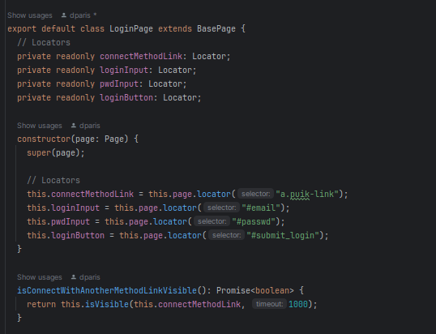

# Page Object Model

Page Object Model - POM - is a design pattern used in test automation to organize source code, improve maintainability and reusability of the code.

Core concept: every âge of the web application has own "class" with a methods/functions responsible for operations on this page.

 * DRY - Don't repeat Yourself
   This means you don't have to write the same code twice.

 * KISS - Keep It Simple Stupid
   This means complexity is superfluous (keep it simple) if it adds nothing (stupid)

Voici la manière dont Playwright recommande d'organiser les objets de la page et l'argument principal qui sous-tend cette approche.
Pourquoi avons-nous besoin d'utiliser les localisateurs indépendamment des méthodes fonctionnelles ?
Parce que vous pouvez réutiliser l'instance qui pointe vers le localisateur dans différentes méthodes à l'intérieur de l'objet page de la page.
Ainsi, vous ne dupliquez pas vos localisateurs et votre localisateur devient unique.

PageManager
   On lit le test comme si on parlait en langage naturel