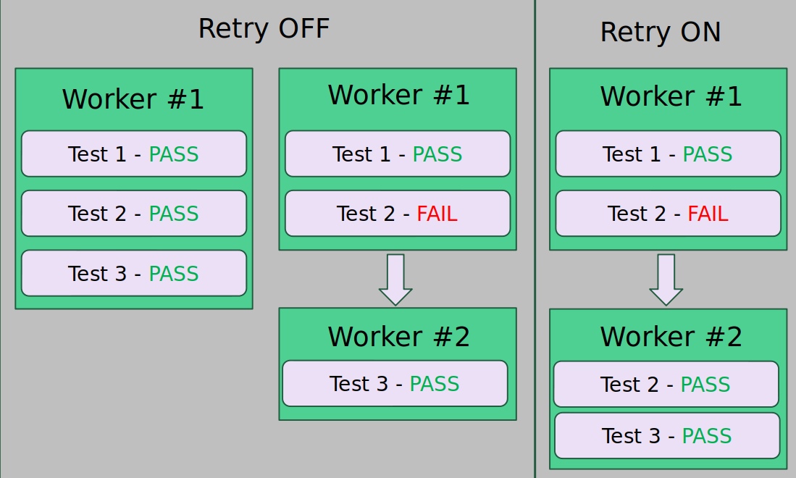

# Retry feature

Retry is the mechanism in the playwright that can retry a failed test.
Every time test is retried, playwright will create a new worker to make sure that test runs in complete isolation.

## Worker & Retry

Worker is in a high level is a new instance of the browser running in the incognito mode for each spec files (by default) and execute them in parallel.
Playwright by default, try to reuse the existing worker just to save the time and save the resources on the machine.

* Retry Off: when the test is failed, Playwright creates a new worker, and the next test will be executed in a new worker to make sure that test will be executed in the completely clean session.
* Retry On:  when the test fail, playwright create a new worker and retry execution of the test.



## Retry config

The way to configure retry is inside of a playwright.config.ts

```sh
 retries: process.env.CI ? 2 : 1,
```

Also, override the counter additionaly inside of the test provinding the setting test describe.
In this case, the test inside of this describe block will use more retries compared to the ones defined in the config.

```sh
    test.describe('From category page', () => {
        test.describe.configure({retries: 2});
        ...
    });
```

Test need to run certain precondition or clean the data before the second retry

```sh
    test.describe('From category page', () => {
        test.describe.configure({retries: 2});
    
        test('go to Categories', async ({ page }, testInfo) => {
            if(testInfo.retry) {
                //do something
            }
            ...
        });
        ...
    })
            
```

