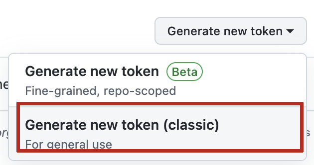
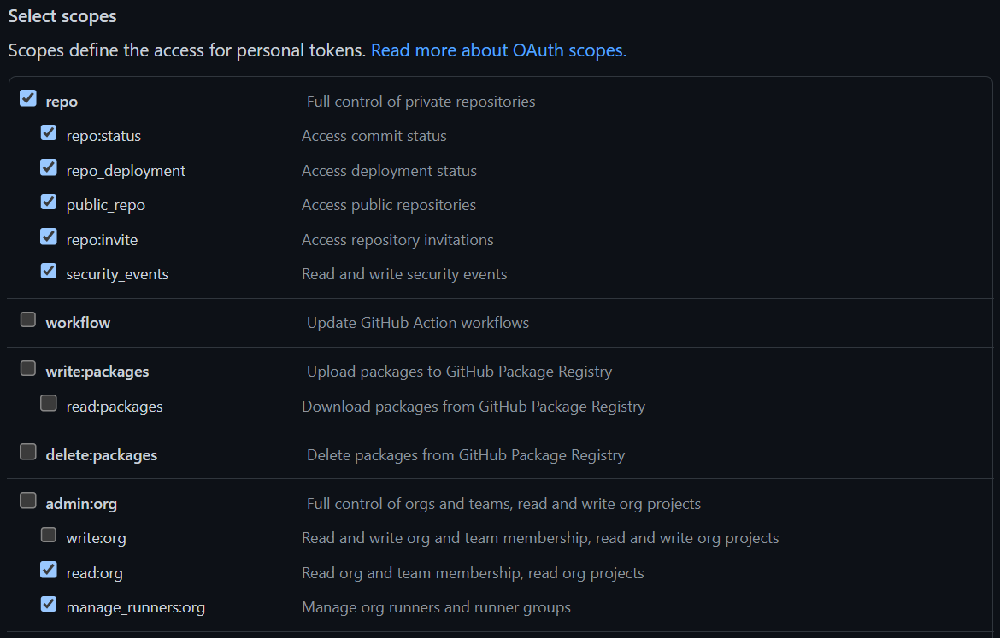

# E2E tests Env

This test environment lets you run a shop exposed via My-Tun.
The ps_accounts module is installed. Depending on configuration, the shop may or may not be associated.

## Pre-requisites

- **[git](https://git-scm.com/book/en/v2/Getting-Started-Installing-Git)** to retrieve source code
- a **[GitHub](https://github.com/PrestaShopCorp)** account, with access to the following projects:
    - [ps_account](https://github.com/PrestaShopCorp/ps_accounts)
- **[docker](https://docs.docker.com/engine/install/)** recommended version >= 24 (`docker --version`)
- **[docker compose](https://docs.docker.com/compose/)** version: >= 2.20.2 (`docker compose version`)
- (now optional) **[Ngrok](https://dashboard.ngrok.com/signup)** account (_free_) to expose your shop online
- **[MyTun](https://www.notion.so/prestashopcorp/Cloudflare-Tunnel-MyTun-ebae06bea81c4a1db8e4b6a392df59a3)** credentials

## References

- PrestaShop FlashLight images: https://github.com/PrestaShop/prestashop-flashlight

## Configure

### Prepare your .env file

First of all copy the default `.env.dist` and edit it upon your needs:

```sh
cp .env.dist .env
edit .env
```

Customize the following variables:

1. `ACCOUNT_TAG=xxxxxxx`
2. `TUNNEL_SECRET=xxxxxxx`
3. `TUNNEL_ID=xxxxxxx`
4. `PS_DOMAIN=prestashop.xxxx-mytun.prestashop.name`

### Github token

To get your **GITHUB_API_TOKEN**, from your GitHub [account developer settings](https://github.com/settings/apps), go
to:

_Settings > Developer Settings > Personal access tokens > Tokens (classic)_

then create a new token:



And set these permissions:



| Pro-tip: set your expiration setting to **"No expiration"** if it's aimed to be used on your machine. It will prevent
troubles on your env in few months ;)

## ps_accounts module

### Auto onboarding 

Set the following variable:

1. `ACCOUNTS_FAKE_ONBOARDING=false`

## Start your environment

```sh
docker compose build --no-cache
docker compose pull
docker compose up -d --wait
# stop
docker compose down -v
```
## Use

### Authentication

Every login asked in this environment will be **`admin@prestashop.com`** or **`prestashop`** accordingly to the context.

Every password asked in this environment will be **`prestashop`**.

### The env is battery included

Extra tool is started up by default:

- [phpMyAdmin](https://www.phpmyadmin.net/)

Start them like so:

```sh
docker compose up -d phpmyadmin
```

### Everything is available from your browser

If you run the default .env.dist, here are useful links to open in your browser:

- http://localhost:8000 the front-office URL (redirects you to https://prestashop.xxxx-mytun.prestashop.name/admin-dev once apache is ready)
- http://localhost:8000/admin-dev the back-office URL (admin@prestashop.com / prestashop)
- http://localhost:6060 the phpMyAdmin Web UI (admin@prestashop.com / prestashop)

# Database connection

### Connect to MySQL

```sh
docker exec -it mysql mysql -uprestashop -pprestashop prestashop
MariaDB [prestashop]> SELECT * FROM ps_configuration LIMIT 1;
+------------------+---------------+---------+-----------------+-------+---------------------+---------------------+
| id_configuration | id_shop_group | id_shop | name            | value | date_add            | date_upd            |
+------------------+---------------+---------+-----------------+-------+---------------------+---------------------+
|                1 |          NULL |    NULL | PS_LANG_DEFAULT | 1     | 2022-10-17 19:43:15 | 2022-10-17 19:43:15 |
+------------------+---------------+---------+-----------------+-------+---------------------+---------------------+
```

# Q&A

**I do have cache issue while testing, what can I do?**

```sh
docker compose build --no-cache
docker compose up -d
```

If you aim at removing all the images prior to a from-scratch boot up:

```sh
docker compose down --remove-orphans --rmi all
```

**How do I set the PrestaShop in debug mode?**

You shall use the DEBUG_MODE var of [PrestaShop Flashlight](https://github.com/PrestaShop/prestashop-flashlight#run-environment-variables) in your docker-compose.yml.
Otherwise you can still do it manually like this:

```sh
docker exec -it prestashop bash
apt-get update
apt-get install nano
nano config/defines.inc.php
# edit _PS_MODE_DEV_ to set it true, then Ctrl+O Ctrl+X to save and quit
```

No need to restart anything. Seems not to be available